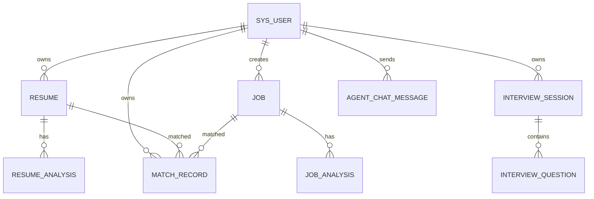

# 智能求职辅助平台：数据库设计

- 文档版本：V1.0
- 数据库：MySQL 8.x
- 字符集：utf8mb4
- 设计说明：以下为可执行的初版 DDL。执行前请先备份已有同名数据库/表。
- 统一约定：主键使用 BIGINT；时间字段由应用层或数据库统一维护；业务表保留 `created_at`，需要更新的表保留 `updated_at`。

## 1. 数据库创建

```sql
CREATE DATABASE IF NOT EXISTS job_assistant
  CHARACTER SET utf8mb4
  COLLATE utf8mb4_0900_ai_ci;

USE job_assistant;
```

如果目标 MySQL 版本不支持 `utf8mb4_0900_ai_ci`，改用 `utf8mb4_unicode_ci`。

## 2. 完整建表 SQL

```sql
CREATE TABLE sys_user (
  id BIGINT PRIMARY KEY AUTO_INCREMENT,
  username VARCHAR(50) NOT NULL,
  email VARCHAR(100) NOT NULL,
  password VARCHAR(255) NOT NULL COMMENT 'BCrypt 哈希，不存明文',
  nickname VARCHAR(50) DEFAULT NULL,
  avatar VARCHAR(500) DEFAULT NULL,
  status TINYINT NOT NULL DEFAULT 1 COMMENT '1正常，0禁用',
  created_at DATETIME NOT NULL DEFAULT CURRENT_TIMESTAMP,
  updated_at DATETIME NOT NULL DEFAULT CURRENT_TIMESTAMP ON UPDATE CURRENT_TIMESTAMP,
  UNIQUE KEY uk_sys_user_username (username),
  UNIQUE KEY uk_sys_user_email (email)
) ENGINE=InnoDB DEFAULT CHARSET=utf8mb4 COMMENT='用户表';

CREATE TABLE resume (
  id BIGINT PRIMARY KEY AUTO_INCREMENT,
  user_id BIGINT NOT NULL,
  name VARCHAR(100) NOT NULL,
  file_name VARCHAR(255) NOT NULL COMMENT '用户上传时的原始文件名',
  file_type VARCHAR(20) NOT NULL COMMENT 'PDF/DOCX',
  file_path VARCHAR(500) NOT NULL COMMENT '服务端存储路径，不向前端暴露绝对路径',
  content LONGTEXT NOT NULL COMMENT '提取的简历文本',
  status TINYINT NOT NULL DEFAULT 1 COMMENT '1有效，0已删除/停用',
  created_at DATETIME NOT NULL DEFAULT CURRENT_TIMESTAMP,
  updated_at DATETIME NOT NULL DEFAULT CURRENT_TIMESTAMP ON UPDATE CURRENT_TIMESTAMP,
  KEY idx_resume_user_created (user_id, created_at),
  CONSTRAINT fk_resume_user FOREIGN KEY (user_id) REFERENCES sys_user(id)
) ENGINE=InnoDB DEFAULT CHARSET=utf8mb4 COMMENT='简历表';

CREATE TABLE resume_analysis (
  id BIGINT PRIMARY KEY AUTO_INCREMENT,
  resume_id BIGINT NOT NULL,
  version_no INT NOT NULL DEFAULT 1,
  summary TEXT,
  skills JSON,
  education JSON,
  projects JSON,
  experience JSON,
  advantages JSON,
  weaknesses JSON,
  suggestions JSON,
  model_name VARCHAR(100),
  status VARCHAR(20) NOT NULL DEFAULT 'SUCCESS' COMMENT 'SUCCESS/FAILED',
  error_message VARCHAR(500) DEFAULT NULL,
  created_at DATETIME NOT NULL DEFAULT CURRENT_TIMESTAMP,
  UNIQUE KEY uk_resume_analysis_version (resume_id, version_no),
  KEY idx_resume_analysis_resume_created (resume_id, created_at),
  CONSTRAINT fk_resume_analysis_resume FOREIGN KEY (resume_id) REFERENCES resume(id)
) ENGINE=InnoDB DEFAULT CHARSET=utf8mb4 COMMENT='简历分析结果';

CREATE TABLE job (
  id BIGINT PRIMARY KEY AUTO_INCREMENT,
  user_id BIGINT NOT NULL,
  company_name VARCHAR(100) DEFAULT NULL,
  job_name VARCHAR(100) NOT NULL,
  description LONGTEXT NOT NULL,
  status TINYINT NOT NULL DEFAULT 1 COMMENT '1有效，0已删除/停用',
  created_at DATETIME NOT NULL DEFAULT CURRENT_TIMESTAMP,
  updated_at DATETIME NOT NULL DEFAULT CURRENT_TIMESTAMP ON UPDATE CURRENT_TIMESTAMP,
  KEY idx_job_user_created (user_id, created_at),
  CONSTRAINT fk_job_user FOREIGN KEY (user_id) REFERENCES sys_user(id)
) ENGINE=InnoDB DEFAULT CHARSET=utf8mb4 COMMENT='目标岗位';

CREATE TABLE job_analysis (
  id BIGINT PRIMARY KEY AUTO_INCREMENT,
  job_id BIGINT NOT NULL,
  version_no INT NOT NULL DEFAULT 1,
  responsibilities JSON,
  required_skills JSON,
  preferred_skills JSON,
  education_requirement VARCHAR(255),
  experience_requirement VARCHAR(255),
  technology_stack JSON,
  soft_skills JSON,
  summary TEXT,
  model_name VARCHAR(100),
  status VARCHAR(20) NOT NULL DEFAULT 'SUCCESS',
  error_message VARCHAR(500) DEFAULT NULL,
  created_at DATETIME NOT NULL DEFAULT CURRENT_TIMESTAMP,
  UNIQUE KEY uk_job_analysis_version (job_id, version_no),
  KEY idx_job_analysis_job_created (job_id, created_at),
  CONSTRAINT fk_job_analysis_job FOREIGN KEY (job_id) REFERENCES job(id)
) ENGINE=InnoDB DEFAULT CHARSET=utf8mb4 COMMENT='岗位分析结果';

CREATE TABLE match_record (
  id BIGINT PRIMARY KEY AUTO_INCREMENT,
  user_id BIGINT NOT NULL,
  resume_id BIGINT NOT NULL,
  job_id BIGINT NOT NULL,
  resume_analysis_id BIGINT DEFAULT NULL,
  job_analysis_id BIGINT DEFAULT NULL,
  match_score DECIMAL(5,2) NOT NULL COMMENT '0.00至100.00',
  matched_items JSON,
  partial_items JSON,
  missing_items JSON,
  dimension_scores JSON,
  suggestions JSON,
  summary TEXT,
  created_at DATETIME NOT NULL DEFAULT CURRENT_TIMESTAMP,
  KEY idx_match_user_created (user_id, created_at),
  KEY idx_match_resume_job (resume_id, job_id),
  CONSTRAINT fk_match_user FOREIGN KEY (user_id) REFERENCES sys_user(id),
  CONSTRAINT fk_match_resume FOREIGN KEY (resume_id) REFERENCES resume(id),
  CONSTRAINT fk_match_job FOREIGN KEY (job_id) REFERENCES job(id),
  CONSTRAINT fk_match_resume_analysis FOREIGN KEY (resume_analysis_id) REFERENCES resume_analysis(id),
  CONSTRAINT fk_match_job_analysis FOREIGN KEY (job_analysis_id) REFERENCES job_analysis(id)
) ENGINE=InnoDB DEFAULT CHARSET=utf8mb4 COMMENT='简历岗位匹配记录';

CREATE TABLE interview_session (
  id BIGINT PRIMARY KEY AUTO_INCREMENT,
  user_id BIGINT NOT NULL,
  job_id BIGINT NOT NULL,
  title VARCHAR(100) NOT NULL,
  question_type VARCHAR(30) NOT NULL DEFAULT 'MIXED',
  question_count INT NOT NULL DEFAULT 5,
  status TINYINT NOT NULL DEFAULT 0 COMMENT '0进行中，1已完成，2已取消',
  total_score DECIMAL(5,2) DEFAULT NULL,
  created_at DATETIME NOT NULL DEFAULT CURRENT_TIMESTAMP,
  completed_at DATETIME DEFAULT NULL,
  KEY idx_interview_user_created (user_id, created_at),
  CONSTRAINT fk_interview_user FOREIGN KEY (user_id) REFERENCES sys_user(id),
  CONSTRAINT fk_interview_job FOREIGN KEY (job_id) REFERENCES job(id)
) ENGINE=InnoDB DEFAULT CHARSET=utf8mb4 COMMENT='面试会话';

CREATE TABLE interview_question (
  id BIGINT PRIMARY KEY AUTO_INCREMENT,
  session_id BIGINT NOT NULL,
  question TEXT NOT NULL,
  question_category VARCHAR(50) DEFAULT NULL,
  answer TEXT,
  reference_answer TEXT,
  score DECIMAL(5,2) DEFAULT NULL,
  analysis TEXT,
  suggestions JSON,
  sort_order INT NOT NULL DEFAULT 1,
  created_at DATETIME NOT NULL DEFAULT CURRENT_TIMESTAMP,
  KEY idx_interview_question_session_order (session_id, sort_order),
  CONSTRAINT fk_interview_question_session FOREIGN KEY (session_id) REFERENCES interview_session(id)
) ENGINE=InnoDB DEFAULT CHARSET=utf8mb4 COMMENT='面试题与回答';

CREATE TABLE agent_chat_message (
  id BIGINT PRIMARY KEY AUTO_INCREMENT,
  user_id BIGINT NOT NULL,
  session_id VARCHAR(64) NOT NULL COMMENT '应用层生成的会话标识',
  role VARCHAR(20) NOT NULL COMMENT 'user/assistant/tool',
  content LONGTEXT,
  tool_name VARCHAR(100) DEFAULT NULL,
  tool_arguments JSON DEFAULT NULL,
  tool_result JSON DEFAULT NULL,
  created_at DATETIME NOT NULL DEFAULT CURRENT_TIMESTAMP,
  KEY idx_agent_session_created (user_id, session_id, created_at),
  CONSTRAINT fk_agent_message_user FOREIGN KEY (user_id) REFERENCES sys_user(id)
) ENGINE=InnoDB DEFAULT CHARSET=utf8mb4 COMMENT='智能体对话与工具调用记录';
```

## 3. 表用途

| 表 | 说明 |
|---|---|
| sys_user | 用户与认证信息 |
| resume | 原始简历元数据及提取文本 |
| resume_analysis | 简历 AI 分析的历史版本 |
| job | 用户录入的目标岗位 |
| job_analysis | 岗位 AI 分析的历史版本 |
| match_record | 某份简历与某个岗位的一次匹配结果 |
| interview_session | 一次面试练习会话 |
| interview_question | 面试题、用户回答和评价 |
| agent_chat_message | Agent 用户消息、最终回复和工具调用记录 |

## 4. ER 关系



## 5. 重要实现约束

1. **所有权校验**：外键只能保证数据关系，不能保证当前登录用户有权访问。所有读取、更新、删除操作都必须校验 `user_id`。
2. **分析版本**：新分析建议新增 `version_no`，不要静默覆盖旧结果。创建版本时由事务或可靠的并发控制保证版本唯一。
3. **失败记录**：可以选择只保存成功结果，也可以记录失败状态。不要把模型错误堆栈或敏感信息完整返回给用户。
4. **JSON 字段**：应用层要校验 JSON 结构；MySQL JSON 类型不代表内容自动符合业务 Schema。
5. **匹配分数**：服务层强制限制在 0 到 100 之间。评分算法和维度权重需写入配置或代码常量，并在论文中解释。
6. **删除策略**：第一版建议对简历、岗位采用逻辑删除；如果采用物理删除，需明确删除关联分析和文件的规则。
7. **文件路径**：数据库存储相对路径或存储键，不存放可直接暴露给浏览器的本机绝对路径。
8. **隐私**：简历文本含有个人信息，限制日志输出，并提供删除数据的能力。

## 6. 建议评分维度

初版可以使用可解释的规则评分，不依赖模型随意生成总分：

| 维度 | 建议权重 |
|---|---:|
| 必备技能 | 45% |
| 项目经历相关性 | 25% |
| 工作/实习经历 | 15% |
| 学历与经验要求 | 10% |
| 加分技能 | 5% |
| 合计 | 100% |

评分方法应根据结构化匹配项计算；如果某项岗位要求缺少明确证据，应标记为“无法判断”，而不是直接认定用户不具备。权重可在试验后调整，但同一版本报告应记录使用的评分规则版本。

## 7. 初始化验证

执行建表 SQL 后，使用以下命令检查：

```sql
SHOW TABLES;
DESCRIBE sys_user;
DESCRIBE resume;
DESCRIBE match_record;
```

预期能看到 9 张表。建议再用测试用户验证唯一约束、外键约束和 JSON 字段读写。
