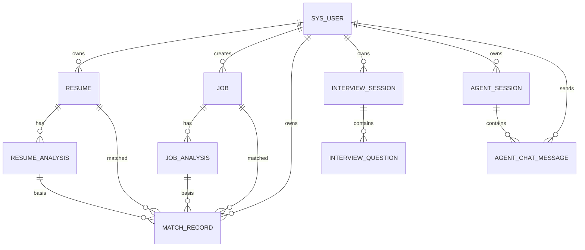

# 智能求职辅助平台：数据库设计

- 文档版本：V1.2
- 修订日期：2026-10-09
- 数据库：MySQL 8.0+（推荐 8.4 LTS）
- 字符集：utf8mb4
- 设计说明：以下为可执行的初版 DDL。执行前请先备份已有同名数据库/表。
- 修订说明：
  - V1.1：依据《设计审查报告》修订，新增 `agent_session` 表，补充 `source_hash` 与 `updated_at` 字段，修正索引冗余与隐式外键索引，明确删除策略
  - V1.2：第二轮审查整改，补 `agent_chat_message` 会话外键（I-4）、匹配分析依据改非空（G-1）、明确 `source_hash` 计算基准（G-2）、明确会话时间戳维护方式（G-8）

## 0. 统一约定

- 主键使用 `BIGINT`；时间字段由应用层或数据库统一维护。
- 业务表保留 `created_at`；**凡会被更新（UPDATE）的表必须保留 `updated_at`**。
- 所有外键**显式声明** `ON DELETE RESTRICT`（第一版采用逻辑删除，不依赖级联删除）。
- 所有外键列**显式建立索引**，不依赖 MySQL 隐式补建。
- JSON 列的读写由应用层通过 MyBatis-Plus 的 JSON TypeHandler 处理，**MySQL 的 JSON 类型不代表内容自动符合业务 Schema**。

---

## 1. 数据库创建

```sql
CREATE DATABASE IF NOT EXISTS career_pilot
  CHARACTER SET utf8mb4
  COLLATE utf8mb4_0900_ai_ci;

USE career_pilot;
```

如果目标 MySQL 版本不支持 `utf8mb4_0900_ai_ci`，改用 `utf8mb4_unicode_ci`。

> 数据库名由 V1.0 的 `job_assistant` 统一为 `career_pilot`，与项目名保持一致。

---

## 2. 完整建表 SQL

共 10 张表。

```sql
-- ============================================================
-- 1. 用户表
-- ============================================================
CREATE TABLE sys_user (
  id BIGINT PRIMARY KEY AUTO_INCREMENT,
  username VARCHAR(50) NOT NULL,
  email VARCHAR(100) NOT NULL,
  password VARCHAR(255) NOT NULL COMMENT 'BCrypt 哈希，不存明文',
  nickname VARCHAR(50) DEFAULT NULL,
  avatar VARCHAR(500) DEFAULT NULL,
  status TINYINT NOT NULL DEFAULT 1 COMMENT '1正常，0禁用',
  created_at DATETIME NOT NULL DEFAULT CURRENT_TIMESTAMP,
  updated_at DATETIME NOT NULL DEFAULT CURRENT_TIMESTAMP ON UPDATE CURRENT_TIMESTAMP,
  UNIQUE KEY uk_sys_user_username (username),
  UNIQUE KEY uk_sys_user_email (email)
) ENGINE=InnoDB DEFAULT CHARSET=utf8mb4 COMMENT='用户表';

-- ============================================================
-- 2. 简历表
-- ============================================================
CREATE TABLE resume (
  id BIGINT PRIMARY KEY AUTO_INCREMENT,
  user_id BIGINT NOT NULL,
  name VARCHAR(100) NOT NULL,
  file_name VARCHAR(255) NOT NULL COMMENT '用户上传时的原始文件名',
  file_type VARCHAR(20) NOT NULL COMMENT 'PDF/DOCX',
  file_path VARCHAR(500) NOT NULL COMMENT '相对 storage-root 的路径，不向前端暴露',
  content LONGTEXT NOT NULL COMMENT '提取的简历文本（入库前按上限截断）',
  status TINYINT NOT NULL DEFAULT 1 COMMENT '1有效，0已删除（逻辑删除）',
  created_at DATETIME NOT NULL DEFAULT CURRENT_TIMESTAMP,
  updated_at DATETIME NOT NULL DEFAULT CURRENT_TIMESTAMP ON UPDATE CURRENT_TIMESTAMP,
  KEY idx_resume_user_created (user_id, created_at),
  CONSTRAINT fk_resume_user FOREIGN KEY (user_id) REFERENCES sys_user(id) ON DELETE RESTRICT
) ENGINE=InnoDB DEFAULT CHARSET=utf8mb4 COMMENT='简历表';

-- ============================================================
-- 3. 简历分析结果
-- ============================================================
CREATE TABLE resume_analysis (
  id BIGINT PRIMARY KEY AUTO_INCREMENT,
  resume_id BIGINT NOT NULL,
  version_no INT NOT NULL DEFAULT 1 COMMENT '同一简历的分析版本号，从 1 递增',
  source_hash VARCHAR(64) DEFAULT NULL COMMENT '分析时简历文本的 SHA-256，用于判断能否复用',
  summary TEXT,
  skills JSON,
  education JSON,
  projects JSON,
  experience JSON,
  advantages JSON,
  weaknesses JSON,
  suggestions JSON,
  model_name VARCHAR(100) COMMENT '实际调用的模型名',
  status VARCHAR(20) NOT NULL DEFAULT 'SUCCESS' COMMENT 'SUCCESS/FAILED',
  error_message VARCHAR(500) DEFAULT NULL COMMENT '仅排查用，不向前端返回',
  created_at DATETIME NOT NULL DEFAULT CURRENT_TIMESTAMP,
  UNIQUE KEY uk_resume_analysis_version (resume_id, version_no),
  KEY idx_resume_analysis_hash (resume_id, source_hash),
  CONSTRAINT fk_resume_analysis_resume FOREIGN KEY (resume_id) REFERENCES resume(id) ON DELETE RESTRICT
) ENGINE=InnoDB DEFAULT CHARSET=utf8mb4 COMMENT='简历分析结果';

-- ============================================================
-- 4. 目标岗位
-- ============================================================
CREATE TABLE job (
  id BIGINT PRIMARY KEY AUTO_INCREMENT,
  user_id BIGINT NOT NULL,
  company_name VARCHAR(100) DEFAULT NULL,
  job_name VARCHAR(100) NOT NULL,
  description LONGTEXT NOT NULL,
  status TINYINT NOT NULL DEFAULT 1 COMMENT '1有效，0已删除（逻辑删除）',
  created_at DATETIME NOT NULL DEFAULT CURRENT_TIMESTAMP,
  updated_at DATETIME NOT NULL DEFAULT CURRENT_TIMESTAMP ON UPDATE CURRENT_TIMESTAMP,
  KEY idx_job_user_created (user_id, created_at),
  CONSTRAINT fk_job_user FOREIGN KEY (user_id) REFERENCES sys_user(id) ON DELETE RESTRICT
) ENGINE=InnoDB DEFAULT CHARSET=utf8mb4 COMMENT='目标岗位';

-- ============================================================
-- 5. 岗位分析结果
-- ============================================================
CREATE TABLE job_analysis (
  id BIGINT PRIMARY KEY AUTO_INCREMENT,
  job_id BIGINT NOT NULL,
  version_no INT NOT NULL DEFAULT 1 COMMENT '同一岗位的分析版本号，从 1 递增',
  source_hash VARCHAR(64) DEFAULT NULL COMMENT '分析时岗位描述的 SHA-256，用于判断能否复用与是否过期',
  responsibilities JSON,
  required_skills JSON,
  preferred_skills JSON,
  education_requirement VARCHAR(255),
  experience_requirement VARCHAR(255),
  technology_stack JSON,
  soft_skills JSON,
  summary TEXT,
  model_name VARCHAR(100),
  status VARCHAR(20) NOT NULL DEFAULT 'SUCCESS' COMMENT 'SUCCESS/FAILED',
  error_message VARCHAR(500) DEFAULT NULL,
  created_at DATETIME NOT NULL DEFAULT CURRENT_TIMESTAMP,
  UNIQUE KEY uk_job_analysis_version (job_id, version_no),
  KEY idx_job_analysis_hash (job_id, source_hash),
  CONSTRAINT fk_job_analysis_job FOREIGN KEY (job_id) REFERENCES job(id) ON DELETE RESTRICT
) ENGINE=InnoDB DEFAULT CHARSET=utf8mb4 COMMENT='岗位分析结果';

-- ============================================================
-- 6. 简历岗位匹配记录
-- ============================================================
CREATE TABLE match_record (
  id BIGINT PRIMARY KEY AUTO_INCREMENT,
  user_id BIGINT NOT NULL,
  resume_id BIGINT NOT NULL,
  job_id BIGINT NOT NULL,
  resume_analysis_id BIGINT NOT NULL COMMENT '本次匹配所依据的简历分析版本，业务上必然存在（见 5.8）',
  job_analysis_id BIGINT NOT NULL COMMENT '本次匹配所依据的岗位分析版本，业务上必然存在（见 5.8）',
  match_score DECIMAL(5,2) NOT NULL COMMENT '0.00至100.00，由后端规则计算',
  matched_items JSON,
  partial_items JSON,
  missing_items JSON,
  dimension_scores JSON,
  suggestions JSON,
  summary TEXT,
  created_at DATETIME NOT NULL DEFAULT CURRENT_TIMESTAMP,
  KEY idx_match_user_created (user_id, created_at),
  KEY idx_match_resume_job (resume_id, job_id),
  KEY idx_match_job (job_id),
  KEY idx_match_resume_analysis (resume_analysis_id),
  KEY idx_match_job_analysis (job_analysis_id),
  CONSTRAINT fk_match_user FOREIGN KEY (user_id) REFERENCES sys_user(id) ON DELETE RESTRICT,
  CONSTRAINT fk_match_resume FOREIGN KEY (resume_id) REFERENCES resume(id) ON DELETE RESTRICT,
  CONSTRAINT fk_match_job FOREIGN KEY (job_id) REFERENCES job(id) ON DELETE RESTRICT,
  CONSTRAINT fk_match_resume_analysis FOREIGN KEY (resume_analysis_id) REFERENCES resume_analysis(id) ON DELETE RESTRICT,
  CONSTRAINT fk_match_job_analysis FOREIGN KEY (job_analysis_id) REFERENCES job_analysis(id) ON DELETE RESTRICT
) ENGINE=InnoDB DEFAULT CHARSET=utf8mb4 COMMENT='简历岗位匹配记录';

-- ============================================================
-- 7. 面试会话
-- ============================================================
CREATE TABLE interview_session (
  id BIGINT PRIMARY KEY AUTO_INCREMENT,
  user_id BIGINT NOT NULL,
  job_id BIGINT NOT NULL,
  title VARCHAR(100) NOT NULL,
  question_type VARCHAR(30) NOT NULL DEFAULT 'MIXED' COMMENT 'JAVA/SPRING/MYSQL/REDIS/PROJECT/MIXED',
  question_count INT NOT NULL DEFAULT 5 COMMENT '计划题目数，创建会话时确定',
  status TINYINT NOT NULL DEFAULT 0 COMMENT '0进行中，1已完成，2已取消',
  total_score DECIMAL(5,2) DEFAULT NULL COMMENT '全部作答完成后计算',
  created_at DATETIME NOT NULL DEFAULT CURRENT_TIMESTAMP,
  updated_at DATETIME NOT NULL DEFAULT CURRENT_TIMESTAMP ON UPDATE CURRENT_TIMESTAMP,
  completed_at DATETIME DEFAULT NULL,
  KEY idx_interview_user_created (user_id, created_at),
  KEY idx_interview_job (job_id),
  CONSTRAINT fk_interview_user FOREIGN KEY (user_id) REFERENCES sys_user(id) ON DELETE RESTRICT,
  CONSTRAINT fk_interview_job FOREIGN KEY (job_id) REFERENCES job(id) ON DELETE RESTRICT
) ENGINE=InnoDB DEFAULT CHARSET=utf8mb4 COMMENT='面试会话';

-- ============================================================
-- 8. 面试题与回答
-- ============================================================
CREATE TABLE interview_question (
  id BIGINT PRIMARY KEY AUTO_INCREMENT,
  session_id BIGINT NOT NULL,
  question TEXT NOT NULL,
  question_category VARCHAR(50) DEFAULT NULL,
  answer TEXT COMMENT '用户回答，未作答为 NULL',
  reference_answer TEXT,
  score DECIMAL(5,2) DEFAULT NULL,
  analysis TEXT,
  suggestions JSON,
  sort_order INT NOT NULL DEFAULT 1 COMMENT '题目顺序，同一会话内唯一',
  created_at DATETIME NOT NULL DEFAULT CURRENT_TIMESTAMP,
  updated_at DATETIME NOT NULL DEFAULT CURRENT_TIMESTAMP ON UPDATE CURRENT_TIMESTAMP,
  UNIQUE KEY uk_interview_question_order (session_id, sort_order),
  CONSTRAINT fk_interview_question_session FOREIGN KEY (session_id) REFERENCES interview_session(id) ON DELETE RESTRICT
) ENGINE=InnoDB DEFAULT CHARSET=utf8mb4 COMMENT='面试题与回答';

-- ============================================================
-- 9. 智能体会话
-- ============================================================
CREATE TABLE agent_session (
  id BIGINT PRIMARY KEY AUTO_INCREMENT,
  user_id BIGINT NOT NULL,
  session_id VARCHAR(64) NOT NULL COMMENT '应用层生成的会话标识（UUID）',
  title VARCHAR(100) NOT NULL COMMENT '会话标题，取首条用户消息的前若干字符',
  created_at DATETIME NOT NULL DEFAULT CURRENT_TIMESTAMP,
  updated_at DATETIME NOT NULL DEFAULT CURRENT_TIMESTAMP ON UPDATE CURRENT_TIMESTAMP COMMENT '会话列表排序依据；写入新消息时须由应用层显式更新（见 5.9）',
  UNIQUE KEY uk_agent_session_sid (session_id),
  KEY idx_agent_session_user (user_id, updated_at),
  CONSTRAINT fk_agent_session_user FOREIGN KEY (user_id) REFERENCES sys_user(id) ON DELETE RESTRICT
) ENGINE=InnoDB DEFAULT CHARSET=utf8mb4 COMMENT='智能体会话';

-- ============================================================
-- 10. 智能体对话与工具调用记录
-- ============================================================
CREATE TABLE agent_chat_message (
  id BIGINT PRIMARY KEY AUTO_INCREMENT,
  user_id BIGINT NOT NULL,
  session_id VARCHAR(64) NOT NULL COMMENT '关联 agent_session.session_id',
  role VARCHAR(20) NOT NULL COMMENT 'user/assistant/tool',
  content LONGTEXT,
  tool_name VARCHAR(100) DEFAULT NULL COMMENT 'role=tool 时记录工具名',
  tool_arguments JSON DEFAULT NULL COMMENT 'role=tool 时记录入参',
  tool_result JSON DEFAULT NULL COMMENT 'role=tool 时记录（脱敏后的）结果摘要',
  created_at DATETIME NOT NULL DEFAULT CURRENT_TIMESTAMP,
  KEY idx_agent_session_created (user_id, session_id, created_at),
  KEY idx_agent_message_session (session_id),
  CONSTRAINT fk_agent_message_user FOREIGN KEY (user_id) REFERENCES sys_user(id) ON DELETE RESTRICT,
  CONSTRAINT fk_agent_message_session FOREIGN KEY (session_id) REFERENCES agent_session(session_id) ON DELETE RESTRICT
) ENGINE=InnoDB DEFAULT CHARSET=utf8mb4 COMMENT='智能体对话与工具调用记录';
```

---

## 3. 表用途

| 表 | 说明 |
|---|---|
| sys_user | 用户与认证信息 |
| resume | 原始简历元数据及提取文本 |
| resume_analysis | 简历 AI 分析的历史版本 |
| job | 用户录入的目标岗位 |
| job_analysis | 岗位 AI 分析的历史版本 |
| match_record | 某份简历与某个岗位的一次匹配结果 |
| interview_session | 一次面试练习会话 |
| interview_question | 面试题、用户回答和评价 |
| agent_session | 智能体会话元数据（V1.1 新增） |
| agent_chat_message | Agent 用户消息、最终回复和工具调用记录 |

---

## 4. ER 关系



---

## 5. 重要实现约束

### 5.1 所有权校验

外键只能保证数据关系，不能保证当前登录用户有权访问。**所有读取、更新、删除操作都必须校验 `user_id`**。

注意 `match_record`、`interview_session` 同时持有 `user_id` 与其引用的资源 ID，属于冗余字段。服务层必须保证：创建时 `resume_id`、`job_id` 均属于同一 `user_id`；查询时以 `user_id` 过滤。

### 5.2 分析版本与复用

- 新分析一律新增 `version_no`，不覆盖旧结果。
- 创建版本时由事务或可靠的并发控制保证版本唯一（推荐 `SELECT MAX(version_no) + 1` 配合唯一索引重试）。
- **是否复用已有分析**：比较当前入库文本的 SHA-256 与最新成功记录的 `source_hash`，一致则直接复用，不一致则生成新版本。
- **`source_hash` 的计算基准（必须固定）**：
  - 简历：对**入库后的 `resume.content`** 计算 SHA-256。该文本在入库前已按 20000 字符上限截断，因此**不得**重新从原始文件提取全文再计算——否则每次计算结果都不同，复用判断将永久失效。
  - 岗位：对 `job.description` 计算 SHA-256（入库前已按 10000 字符上限校验，不做截断）。
- **岗位分析是否过期**：岗位描述更新后其 `source_hash` 必然变化，据此判定旧分析已过期（无需额外状态值）。

### 5.3 失败记录

**第一版只保存成功结果**（`status = 'SUCCESS'`）。模型调用失败时仅记录脱敏日志，不写入 `resume_analysis` / `job_analysis`。`status` 与 `error_message` 字段保留以备后续扩展。

> 说明：系统架构设计 V1.0 要求"不保存无效结果"，数据库 V1.0 又设计了 FAILED 状态，两者取向相反。V1.1 统一为"只存成功结果"。

### 5.4 删除策略（明确）

| 对象 | 策略 |
|---|---|
| 简历 | **逻辑删除**：`resume.status = 0`；同时**物理删除**磁盘上的简历文件 |
| 岗位 | **逻辑删除**：`job.status = 0` |
| 简历分析 / 岗位分析 / 匹配记录 / 面试记录 / Agent 记录 | 保留，不随父资源删除；可见性由父表 `status` 决定 |
| 用户 | 第一版不提供注销功能；如需提供，须一并处理上述全部关联数据 |

由于全部采用逻辑删除，`ON DELETE RESTRICT` 外键不会在正常业务中被触发，仅用于防止误删。

### 5.5 JSON 字段

- 应用层必须校验 JSON 结构后再写入，读取后同样按 DTO 校验。
- MyBatis-Plus 需要为 JSON 字段配置 TypeHandler（如 `JacksonTypeHandler`）并配合 `@TableField(typeHandler = ...)` 与 `autoResultMap = true` 使用。
- **【待验证】** 本项目使用 Spring Boot 4.1.1（Jackson 3，包名 `tools.jackson`）。MyBatis-Plus 官方已在 3.5.15 起声明支持 Jackson 3，但具体可用的 TypeHandler 类名需在接入时按实际版本确认，验证记录见《设计审查报告》。若官方尚未提供 Jackson 3 版本，可退化为在应用层手动完成 JSON 字符串与对象的互转。

### 5.6 匹配分数的并发与范围

- 服务层强制限制匹配分数在 0 到 100 之间（`DECIMAL(5,2)` 已从存储层约束上限）。
- 评分算法和维度权重写入配置或代码常量，并在论文中解释。
- 同一版本报告应记录所使用的评分规则版本（可在 `dimension_scores` 中附带）。

### 5.7 隐私

- 简历文本与 Agent 对话记录含个人信息，限制日志输出。
- 提供删除数据的能力（简历、岗位的逻辑删除即为该能力的体现）。
- `error_message` 等排查字段不向前端返回。

### 5.8 匹配记录的分析依据

`match_record.resume_analysis_id` 与 `job_analysis_id` 定义为 **NOT NULL**，因为两条业务路径都保证分析结果必然存在：

- REST 接口 `POST /api/matches`：缺少任一分析时返回 400，不创建记录；
- Agent 工具 `matchResumeToJob`：由工具内部先补齐缺失的分析（见 Agent 设计文档 4.4），再创建记录。

因此这两个字段不存在为空的情况。若未来需要支持"无分析的直接匹配"，须同时修改本约束与相关接口行为。

### 5.9 智能体会话的时间戳维护

`agent_session.updated_at` 是会话列表的排序依据（API 按此倒序返回）。注意 `ON UPDATE CURRENT_TIMESTAMP` **只在 `agent_session` 行本身被 UPDATE 时触发**，向 `agent_chat_message` 插入新消息不会自动更新它。

因此约定：**每写入一条 `agent_chat_message`，应用层须在同一事务内显式更新对应 `agent_session.updated_at`**（如 `UPDATE agent_session SET updated_at = CURRENT_TIMESTAMP WHERE session_id = ?`）。遗漏此步骤会导致会话列表排序长期不变。

### 5.10 关联数据的删除可见性

简历或岗位被逻辑删除后，其关联的分析、匹配、面试记录**仍然保留且可被查询**（数据可追溯），不使用级联删除。接口层如何呈现这些记录（是否标注源资源已删除）由 API 接口设计文档约定。

---

## 6. 建议评分维度

初版使用可解释的规则评分，不依赖模型随意生成总分：

| 维度 | 建议权重 |
|---|---:|
| 必备技能 | 45% |
| 项目经历相关性 | 25% |
| 工作/实习经历 | 15% |
| 学历与经验要求 | 10% |
| 加分技能 | 5% |
| 合计 | 100% |

评分方法应根据结构化匹配项计算；如果某项岗位要求缺少明确证据，应标记为"无法判断/简历未体现"，而不是直接认定用户不具备。权重可在试验后调整，但同一版本报告应记录使用的评分规则版本。

---

## 7. 初始化验证

执行建表 SQL 后，使用以下命令检查：

```sql
SHOW TABLES;
-- 预期输出 10 张表

DESCRIBE sys_user;
DESCRIBE resume;
DESCRIBE match_record;
DESCRIBE agent_session;

-- 外键与索引核对
SELECT TABLE_NAME, CONSTRAINT_NAME, REFERENCED_TABLE_NAME
  FROM information_schema.KEY_COLUMN_USAGE
 WHERE TABLE_SCHEMA = 'career_pilot' AND REFERENCED_TABLE_NAME IS NOT NULL;
```

建议再用测试用户验证：唯一约束、外键约束（含 RESTRICT 生效）、JSON 字段读写。
